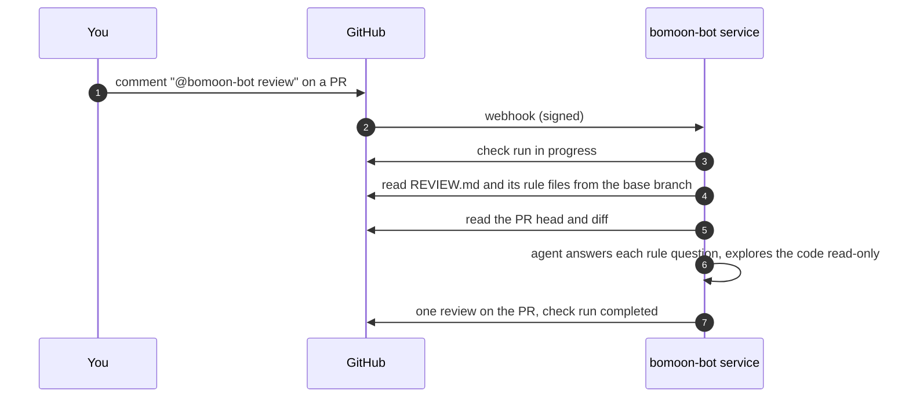

# bomoon-bot

bomoon-bot is a GitHub App that reviews pull requests **with your repository's own rules**. You keep the rules in a `REVIEW.md` at the root of your repo; bomoon-bot reads them, explores the code, and posts one review on the PR.

## Install

1. Install the App on your account or organization: https://github.com/apps/bomoon-bot/installations/new — pick the repositories.
2. Add a `REVIEW.md` to the default branch (format: [docs/review-md.md](docs/review-md.md), example: [examples/REVIEW.md](examples/REVIEW.md)).
3. On a pull request, comment `@bomoon-bot review`. bomoon-bot answers with a check run and one review.

No `REVIEW.md` means a generic review (correctness, security, clear bugs).

## How it works

- The App definition is in [app/manifest.json](app/manifest.json). The review runs on a hosted backend; this repo holds the public interface: the App, the rules format, and the [Review Action](docs/review-action.md).

## Trust and safety

- **Rules come from the base branch** (its current tip), never from the PR, so a PR cannot change the rules it is reviewed by. To change the rules, merge a change to `REVIEW.md` first.
- **Read-only exploration.** The reviewer reads the diff and the code at the PR head with read-only file tools confined to its workspace. It never runs code from the PR.
- **What bomoon-bot writes:** one check run and one review comment per request. It does not approve, request changes, push, or merge (yet).
- **Who can trigger:** comment requests are limited to allowed users; comments from bots are ignored. The Action uses GitHub OIDC and requires the App to be installed on the repository; your workflow chooses its triggers.
- **Permissions:** contents read, pull requests write (to post the review), checks write, issues read, metadata read.

## Status

Early. The standalone [Review Action](docs/review-action.md) is implemented but not yet released or live-verified. It uses the same `REVIEW.md` and reports the App check conclusion. Planned: verdicts (approve / request changes) controlled by the rules, and rule tests that replay past PRs.
